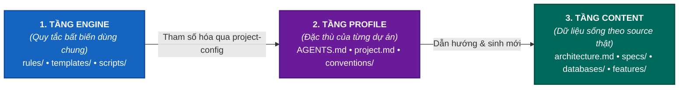
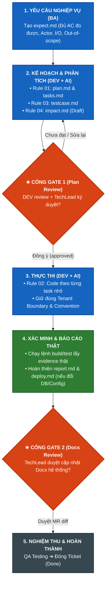

# Project Documentation Kit

Khung **spec-driven development** để BA, DEV, QA, TechLead và AI làm việc với cùng một nguồn sự thật. Repo này quản lý yêu cầu, kiến trúc, tác động, kế hoạch, bằng chứng kiểm thử và triển khai; source code vẫn thuộc các repo/service của dự án.

---

## 1. Ba lớp tài liệu



| Lớp | Nội dung | Khi dùng cho dự án mới |
|---|---|---|
| **ENGINE** | `rules/`, `templates/`, `commands/`, `scripts/` | Giữ nguyên 100%; chỉ thay đổi khi quy trình chung thay đổi. |
| **PROFILE** | `AGENTS.md`, `project.md`, `conventions/`, `*.project-config.md` | Điền lại từ cách vận hành và source thật của dự án. |
| **CONTENT** | `architecture.md`, `specs/`, `databases/`, `design.md`, `features/` | Sinh mới hoàn toàn; tuyệt đối không sao chép fact, schema hoặc ticket dự án cũ. |

---

## 2. Khởi tạo dự án mới (5 bước)

1. Điền metadata, service registry và chính sách an toàn trong `AGENTS.md`.
2. Điền stack, Git/release, data/security policy ở `project.md`.
3. Sao chép hai `rules/*.project-config.template.md` thành file config tương ứng và điền giá trị dự án.
4. Tạo convention cho mỗi nhóm service từ `conventions/_template.md`.
5. Chạy Rule 00 để khảo sát source và **đề xuất** `architecture.md`, `specs/`, `databases/`, `design.md`.

---

## 3. Vòng đời feature & Cổng kiểm soát (Quality Gates)

Mỗi yêu cầu (tính năng mới, sửa lỗi, refactor) đều là một **Case** độc lập nằm tại `features/<TICKET-ID>/`:

### Sơ đồ quy trình (Pipeline Flowchart)



### Sơ đồ rút gọn (Dễ đọc trên mọi môi trường / Text View)

```text
[1. expect.md] ──► [2. plan.md + tasks.md + testcase.md + impact.md]
                                   │
                                   ▼
                      【 GATE 1: TechLead Duyệt Plan 】
                                   │
                                   ▼ (approved)
                      [3. Triển khai Code theo Task]
                                   │
                                   ▼
                      [4. Xác minh thật: report.md + deploy.md]
                                   │
                                   ▼
                      【 GATE 2: TechLead Duyệt Docs 】
                                   │
                                   ▼
                      [5. QA Testing ──► DONE]
```

---

### Bảng phân tích tác dụng của từng tài liệu và cổng kiểm soát

| Thành phần / Tài liệu | Tác dụng để làm gì? | Ai sở hữu? |
| :--- | :--- | :--- |
| **`expect.md`** | **Xác định đề bài chuẩn xác ngay từ đầu:** Ghi rõ hành vi mong đợi, các tác nhân tham gia (Actor), điều kiện đầu vào/đầu ra, tiêu chí chấp nhận đo đếm được (Acceptance Criteria - AC) và vùng không làm (*Out-of-scope*). Đây là **nguồn sự thật duy nhất nắm giữ trạng thái vòng đời của Case** (`draft → plan-review → approved → in-progress → testing → done`). | BA / Product Owner |
| **`plan.md`** | **Bản thiết kế giải pháp kỹ thuật:** Trả lời câu hỏi *"Sẽ giải quyết yêu cầu đó bằng cách nào?"*. Vạch rõ kiến trúc tác động, trace từng bước xử lý về đúng AC, các service bị ảnh hưởng, phương án rollback và kế hoạch test. | DEV + AI Agent |
| **`tasks.md`** | **Bẻ nhỏ kế hoạch thành các đầu việc độc lập:** Phân chia rõ ràng task nào thuộc service/repo nào, dùng trạng thái dạng chữ (`pending`, `in-progress`, `completed`, `blocked`), có lệnh xác minh và tiêu chuẩn hoàn thành cho từng task. Tránh việc một task can thiệp lộn xộn nhiều repo. | DEV + AI Agent |
| **`testcase.md`** | **Bảo vệ tính khách quan của việc kiểm thử:** Sinh trực tiếp từ `expect.md` (chứ không sinh từ `plan.md` hay code). Tác dụng là để kiểm chứng xem giải pháp có đáp ứng đúng nhu cầu nghiệp vụ ban đầu không, tránh bẫy "code thế nào thì test thế ấy". | AI Agent / QA |
| **`impact.md`** | **Đánh giá phạm vi ảnh hưởng (Blast Radius):** Nêu rõ vùng chắc chắn bị ảnh hưởng, vùng đã xác minh an toàn (không bị ảnh hưởng), các rủi ro tiềm ẩn (về hiệu năng, bảo mật, multi-tenant) và các điểm chưa kiểm chứng được. | DEV + AI Agent |
| **Cổng Gate 1** | **Chặn rủi ro trước khi tốn nguồn lực code:** Nguyên tắc bất di bất dịch: **Chưa có Gate 1 phê duyệt (tên TechLead + ngày + link bằng chứng) thì tuyệt đối không được viết code.** Ngăn chặn việc làm sai hướng, làm thừa, phá vỡ kiến trúc hệ thống. | TechLead + DEV |
| **`report.md`** | **Báo cáo kết quả và minh chứng thực tế:** Ghi lại danh sách file thật sự thay đổi, kết quả lệnh build/test thực tế, hạn chế còn tồn đọng và commit/PR hash thật. Không đoán mò hay tường thuật giả lập. | DEV + AI Agent |
| **`deploy.md`** | **Hướng dẫn triển khai an toàn:** Chỉ tạo khi case có thay đổi Database, cấu hình, queue/topic hoặc hạ tầng. Nêu rõ thứ tự chạy script, kịch bản backup, smoke check sau deploy và kế hoạch rollback khi gặp sự cố. | DEV |
| **Cổng Gate 2** | **Chống suy thoái tài liệu nền (Docs Drift):** Khi nghiệp vụ hoặc DB thay đổi, DEV/AI chỉ được *đề xuất diff* vào tài liệu hệ thống (`specs/`, `architecture.md`, `databases/`). TechLead review Gate 2 trước khi merge để đảm bảo tài liệu kiến trúc luôn đúng với source code thật. | TechLead |

---

## 4. Bộ quy tắc vận hành (Rules)

| Rule | Mục đích |
|---|---|
| `00-init-docs` | Khảo sát source và xây dựng tài liệu nền (`architecture.md`, `specs/`, `databases/`, `design.md`). |
| `01-create-plan` | Tạo kế hoạch kỹ thuật, danh sách task và đánh giá tác động từ expectation. |
| `02-implement-task` | Thực thi các task đã được duyệt, xác minh bằng lệnh thực tế và lập báo cáo. |
| `03-create-testcase` | Sinh testcase độc lập trực tiếp từ acceptance criteria của `expect.md`. |
| `04-create-impact` | Xây dựng và chốt đánh giá phạm vi ảnh hưởng (Blast Radius). |

> **Quy định an toàn:** AI không tự phê duyệt Gate 1 / Gate 2, không tự commit, push, merge hoặc deploy nếu chưa được người dùng/owner ủy quyền rõ ràng.
